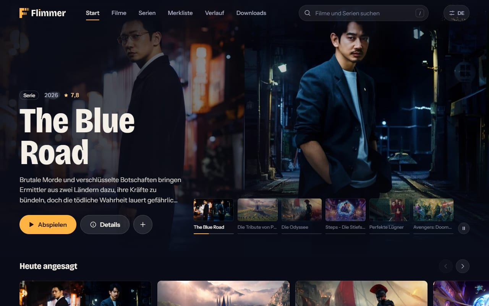
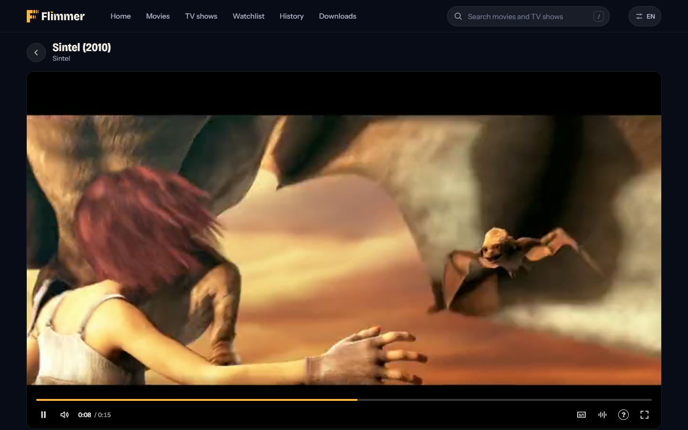
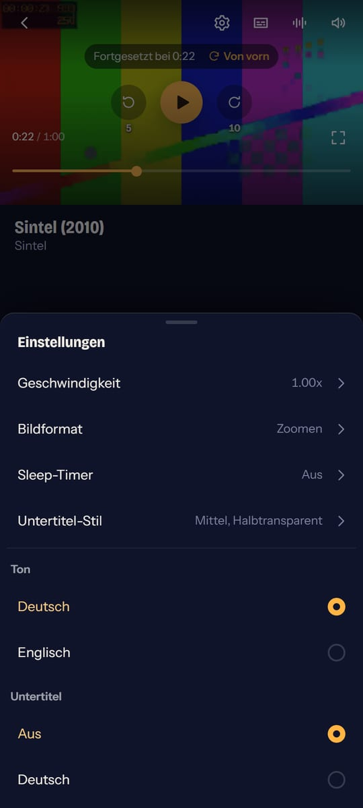

# Flimmer

Flimmer ist eine lokale Film- und Serien-App für Windows und Android, gedacht als Alternative zu Crackle. Alles läuft auf deinem eigenen Gerät: Server, Quellensuche und Player. Einen Konto-Zwang oder einen Cloud-Dienst gibt es nicht.



Stand: Es gibt noch keine fertigen Downloads. Du baust den Windows-Installer und die Android-APK selbst, wie unten beschrieben.

## Was Flimmer kann

- **Stöbern und suchen:** Filme, Serien, Besetzung und Trailer kommen von TMDB. Die Oberfläche gibt es in 12 Sprachen (Deutsch, Englisch, Französisch, Spanisch, Italienisch, Portugiesisch, Russisch, Polnisch, Türkisch, Japanisch, Chinesisch, Koreanisch).
- **Quellen mit eigenem Player:** Flimmer sucht Embed-Quellen in versteckten Browserfenstern und spielt den Stream im eigenen Player ab. Am Desktop blockt uBlock Origin Lite Werbung, am Handy ein Rust-Blocker.
- **Torrents nur durch einen eigenen WireGuard-Tunnel:** Du wählst deine WireGuard-Datei aus (die `.conf` von Proton VPN). Ohne Tunnel startet kein Torrent, fällt der Tunnel aus, fließt kein Torrent-Verkehr. Seeden ist aus.
- **Merkliste, Verlauf, Weiterschauen:** Der Fortschritt bleibt pro Titel und Folge erhalten.
- **Downloads und Auto-Downloads:** Filme und Folgen lassen sich auf die Platte laden, auch regelbasiert.
- **Android ohne PC:** Die APK bringt Server, Quellensuche, Torrents und Player mit. Der PC muss nicht laufen.
- **Handy-Player mit Gesten:** Doppeltipp links springt 5 Sekunden zurück, rechts 10 Sekunden vor, Langdruck spielt mit 2x Tempo, Wischen regelt Helligkeit und Lautstärke. Das Vorbild ist Seanime Mobile.
- **Handy oder Tablet am PC koppeln:** Der WLAN-Modus verbindet weitere Geräte per PIN oder QR-Code mit dem Server auf dem PC.

## Screenshots

Der Testfilm in den Playerbildern ist ein Farbbalken-Testbild, kein echter Spielfilm.

<table>
  <tr>
    <td></td>
    <td></td>
  </tr>
  <tr>
    <td align="center">Titelseite</td>
    <td align="center">Player am Desktop</td>
  </tr>
</table>

<table>
  <tr>
    <td></td>
    <td></td>
    <td></td>
  </tr>
  <tr>
    <td align="center">Startseite</td>
    <td align="center">Player hochkant</td>
    <td align="center">Player-Einstellungen</td>
  </tr>
</table>

## Aufbau

- `desktop/`: Tauri-v2-App für Windows
- `server/`: der Rust-Server (axum), derselbe Code läuft am Desktop und in der Android-App
- `web/`: die Oberfläche mit React, TypeScript und Vite
- `android/`: die eigenständige Android-App
- `docs/`: API, Sicherheit, Android, Mehrsprachigkeit und weitere Notizen

## Selbst bauen

### Windows-Installer

Voraussetzungen:

- Windows mit Rust (Edition 2024) und den MSVC-Buildtools
- Node.js und npm, dann einmal `npm install` im Ordner `web`
- FFmpeg in `tools\ffmpeg\bin` (`ffmpeg.exe` und `ffprobe.exe`)
- uBlock Origin Lite in `desktop\extensions\ubol`

FFmpeg und uBlock Origin Lite liegen nicht im Repository, du legst sie selbst dorthin. Quellen und Lizenzen stehen in [THIRD_PARTY_NOTICES.md](THIRD_PARTY_NOTICES.md).

Dann in PowerShell:

```powershell
.\desktop\build-installer.ps1
```

Das Skript baut zuerst die Oberfläche, dann `Flimmer.exe` ohne Pfade deiner Build-Maschine und zuletzt den Installer. Er landet unter `target\release\bundle\nsis\` als `Flimmer_<Version>_x64-setup.exe` und installiert pro Benutzer.

### Android-APK

Voraussetzungen:

- Android SDK mit NDK und JDK 21
- Rust-Ziel `aarch64-linux-android` (`rustup target add aarch64-linux-android`)
- `npm install` im Ordner `web`

```powershell
.\android\build-apk.ps1
```

Die APK liegt danach in `android\gen\android\app\build\outputs\apk\arm64\release\`. Es gibt nur eine arm64-Version. Zum Signieren legst du `android\gen\android\keystore.properties` an (`storeFile`, `keyAlias`, Passwörter). Ohne diese Datei bleibt die APK unsigniert. Mit `-Inspect` entsteht ein Testbuild, dessen WebViews sich über adb untersuchen lassen. Mehr dazu in [docs/android.md](docs/android.md).

## Erster Start

1. **TMDB-Token:** Flimmer braucht deinen eigenen, kostenlosen TMDB API Read Access Token. Den holst du dir mit einem TMDB-Konto unter themoviedb.org in den API-Einstellungen. Der Startbildschirm fragt danach, einen Token liefert Flimmer nicht mit.
2. **VPN-Datei für Torrents (optional):** Die Einrichtung führt dich zur Proton-WireGuard-Datei: Im Proton-Konto unter Downloads die WireGuard-Konfiguration holen und die `.conf` in Flimmer auswählen. Flimmer legt eine Kopie in seinen eigenen Ordner. Ohne die Datei lassen sich keine Torrents starten.
3. **Torrents ohne VPN:** Das gibt es nur als bewusste Einstellung, die standardmäßig aus ist.

Die Android-App richtest du direkt auf dem Handy ein, die VPN-Datei kommt dort über die Dateiauswahl. Ein per WLAN-Modus gekoppeltes Gerät kann dagegen nur den Server auf dem PC nutzen und dessen Einrichtung nicht ändern.

## Datenschutz und Sicherheit

- Der Server bindet an `127.0.0.1`. Der WLAN-Modus für weitere Geräte ist standardmäßig aus.
- Weitere Geräte koppeln sich per PIN oder QR-Code. PIN und Token gelten nur einmal, falsche PINs werden gebremst.
- Einrichtung, TMDB-Token, VPN-Datei und Download-Ordner kann nur der PC ändern, nicht ein gekoppeltes Gerät.
- Torrents laufen im Programm hinter dem eigenen WireGuard-Tunnel, nicht über deine normale Verbindung.
- Das Bedrohungsmodell, bekannte Lücken und was Flimmer nicht schützt, steht in [docs/security.md](docs/security.md).

## Rechtlicher Hinweis

Flimmer hostet, speichert und verteilt keine Filme oder Serien. Die App ist ein Werkzeug, das Daten von TMDB anzeigt und Quellen im Netz findet. Welche Inhalte du ansiehst oder herunterlädst und ob das in deinem Land erlaubt ist, liegt allein bei dir. Halte dich an die Gesetze deines Landes und an die Rechte der Urheber.

Dieses Produkt nutzt die TMDB-API, wird aber von TMDB weder unterstützt noch zertifiziert.

## Lizenz und Dank

Flimmer steht unter der [GPL-3.0](LICENSE).

Danke an Seanime Mobile: Die Logik des Handy-Players ist daran angelehnt. Die Torrent-Suche folgt dem Ansatz von tork von melqtx. Die Lizenzen und Quellen aller mitgelieferten Software (FFmpeg, uBlock Origin Lite, librqbit, BoringTun, Tauri und weitere) stehen in [THIRD_PARTY_NOTICES.md](THIRD_PARTY_NOTICES.md).
