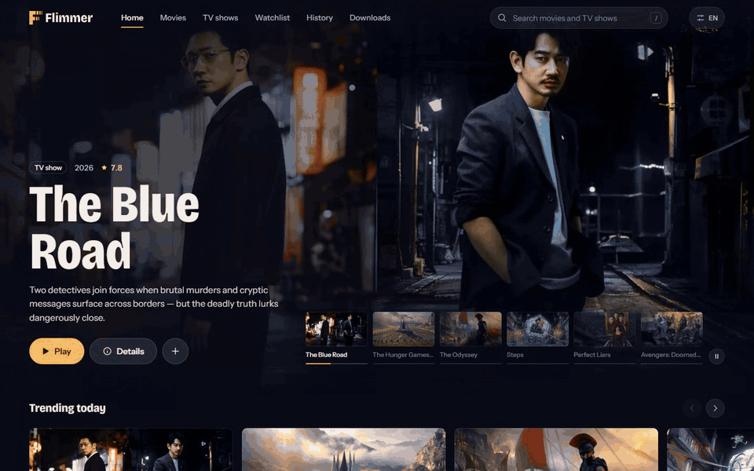
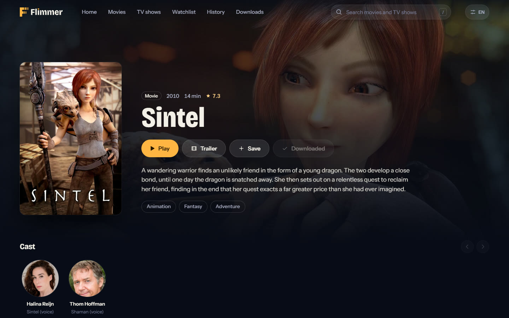
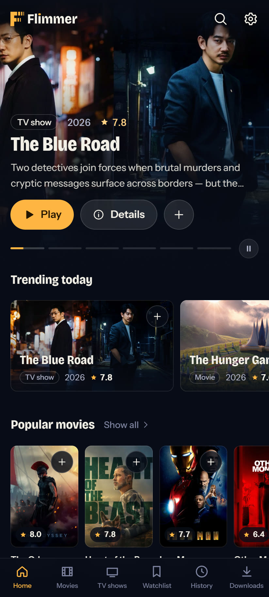
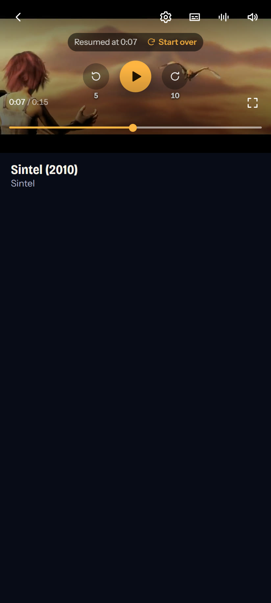
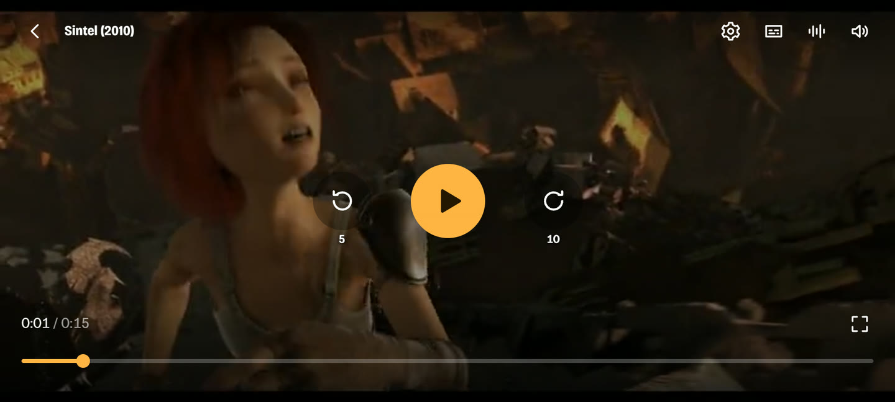
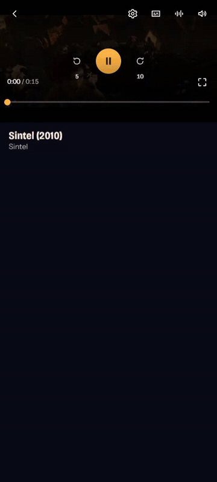

# Flimmer

Flimmer is a local movie and TV app for Windows and Android, meant as an alternative to Crackle. Everything runs on your own device: the server, the source search and the player. No account, no cloud service.



Status: there are no prebuilt downloads yet. You build the Windows installer and the Android APK yourself, as described below.

## Features

- **Browse and search:** movies, shows, cast and trailers come from TMDB. The interface is available in 12 languages (English, German, French, Spanish, Italian, Portuguese, Russian, Polish, Turkish, Japanese, Chinese, Korean).
- **Sources in a built-in player:** Flimmer looks for embed sources in hidden browser windows and plays the stream in its own player. On desktop, uBlock Origin Lite blocks ads. On Android, a blocker written in Rust does the same job.
- **Torrents only through your own WireGuard tunnel:** you pick your WireGuard file (the `.conf` from Proton VPN). Without the tunnel no torrent starts, and if the tunnel drops, torrent traffic stops. Seeding is off.
- **Watchlist, history, continue watching:** progress is saved per title and per episode.
- **Downloads and auto-downloads:** save movies and episodes to disk, by hand or with rules.
- **Android without a PC:** the APK ships the server, source search, torrents and player. Your PC does not need to be running.
- **Phone player with gestures:** double tap left to go back 5 seconds, right to skip ahead 10 seconds. Long press plays at 2x, and swiping adjusts brightness and volume. The design follows Seanime Mobile.
- **Pair a phone or tablet with your PC:** LAN mode connects other devices to the server on your PC with a PIN or QR code.

## Screenshots

### Desktop

<table>
  <tr>
    <td></td>
    <td></td>
  </tr>
  <tr>
    <td align="center">Home</td>
    <td align="center">Title page</td>
  </tr>
  <tr>
    <td colspan="2"></td>
  </tr>
  <tr>
    <td colspan="2" align="center">Player</td>
  </tr>
</table>

### Phone

<table>
  <tr>
    <td></td>
    <td></td>
    <td></td>
  </tr>
  <tr>
    <td align="center">Home</td>
    <td align="center">Player</td>
    <td align="center">Player settings</td>
  </tr>
</table>

<p align="center"></p>

<p align="center"></p>

## Project layout

- `desktop/`: Tauri v2 app for Windows
- `server/`: the Rust server (axum). The same code runs on desktop and inside the Android app
- `web/`: the interface, built with React, TypeScript and Vite
- `android/`: the standalone Android app
- `docs/`: API, security, Android, translations and other notes (mostly in German)

## Building

### Windows installer

You need:

- Windows with Rust (edition 2024) and the MSVC build tools
- Node.js and npm, then run `npm install` once in the `web` folder
- FFmpeg in `tools\ffmpeg\bin` (`ffmpeg.exe` and `ffprobe.exe`)
- uBlock Origin Lite in `desktop\extensions\ubol`

FFmpeg and uBlock Origin Lite are not in the repository, so put them there yourself. Sources and licenses are listed in [THIRD_PARTY_NOTICES.md](THIRD_PARTY_NOTICES.md).

Then, in PowerShell:

```powershell
.\desktop\build-installer.ps1
```

The script builds the interface first, then `Flimmer.exe` (without paths from your build machine), and the installer last. You will find it in `target\release\bundle\nsis\` as `Flimmer_<version>_x64-setup.exe`. It installs per user.

### Android APK

You need:

- Android SDK with the NDK, and JDK 21
- The Rust target `aarch64-linux-android` (`rustup target add aarch64-linux-android`)
- `npm install` in the `web` folder

```powershell
.\android\build-apk.ps1
```

The APK ends up in `android\gen\android\app\build\outputs\apk\arm64\release\`. Only arm64 is built. To sign it, create `android\gen\android\keystore.properties` (`storeFile`, `keyAlias`, passwords). Without that file the APK stays unsigned. `-Inspect` produces a test build whose WebViews you can inspect over adb. More in [docs/android.md](docs/android.md).

## First start

1. **TMDB token:** Flimmer needs your own free TMDB API Read Access Token. Create a TMDB account at themoviedb.org and copy the token from the API settings. The setup screen asks for it. Flimmer does not ship one.
2. **VPN file for torrents (optional):** setup walks you to the Proton WireGuard file. In your Proton account, download a WireGuard configuration from Downloads and select the `.conf` in Flimmer. Flimmer keeps a copy in its own folder. Without the file, torrents cannot start.
3. **Torrents without a VPN:** only as a deliberate setting, and it is off by default.

You set up the Android app on the phone itself, and the VPN file comes in through the file picker. A device paired in LAN mode only uses the server on the PC and cannot change its setup.

## Privacy and security

- The server binds to `127.0.0.1`. LAN mode for other devices is off by default.
- Other devices pair with a PIN or QR code. PINs and tokens work once, and wrong PINs are rate limited.
- Only the PC can change setup, the TMDB token, the VPN file and the download folder. A paired device cannot.
- Torrents run inside the program behind your own WireGuard tunnel, not over your normal connection.
- The threat model, known gaps and what Flimmer does not protect against are in [docs/security.md](docs/security.md).

## Legal notice

Flimmer does not host, store or distribute movies or shows. It is a tool that shows data from TMDB and finds sources on the web. What you watch or download, and whether that is legal where you live, is up to you. Follow the laws of your country and respect the rights of creators.

This product uses the TMDB API but is not endorsed or certified by TMDB.

## License and thanks

Flimmer is licensed under the [GPL-3.0](LICENSE).

Thanks to Seanime Mobile, which the phone player's logic is based on. The torrent search follows the approach of tork by melqtx. Licenses and sources for all bundled software (FFmpeg, uBlock Origin Lite, librqbit, BoringTun, Tauri and more) are in [THIRD_PARTY_NOTICES.md](THIRD_PARTY_NOTICES.md).
